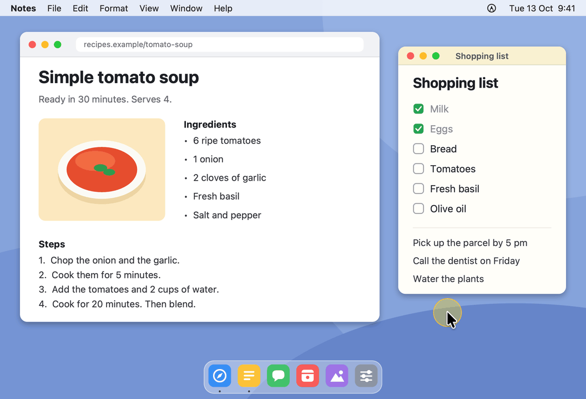
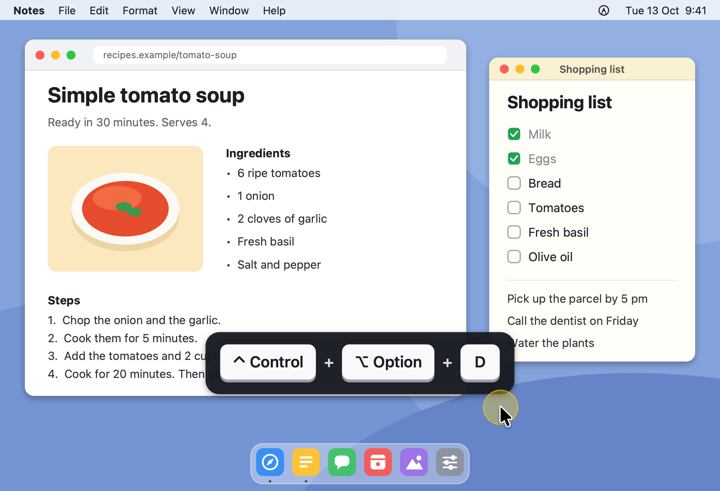
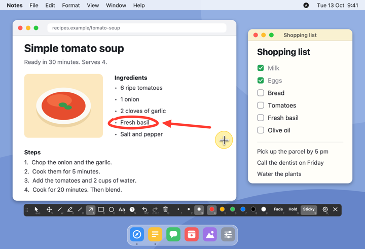
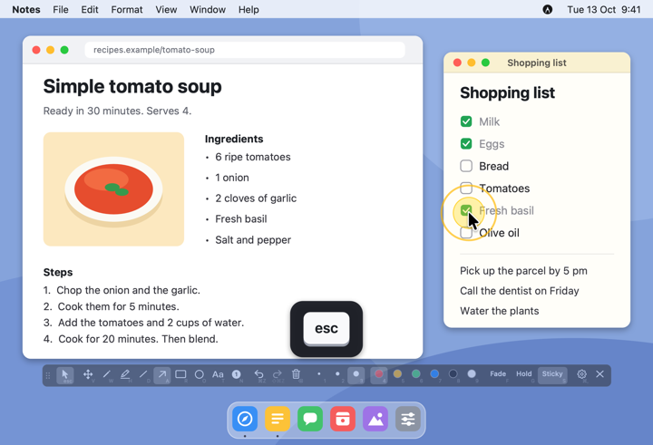
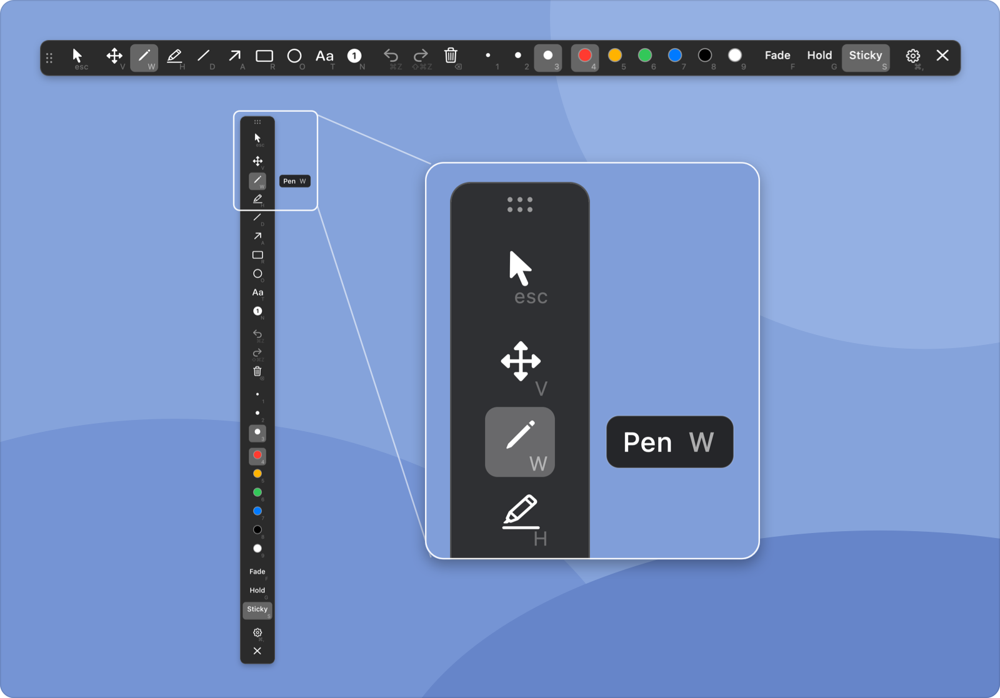
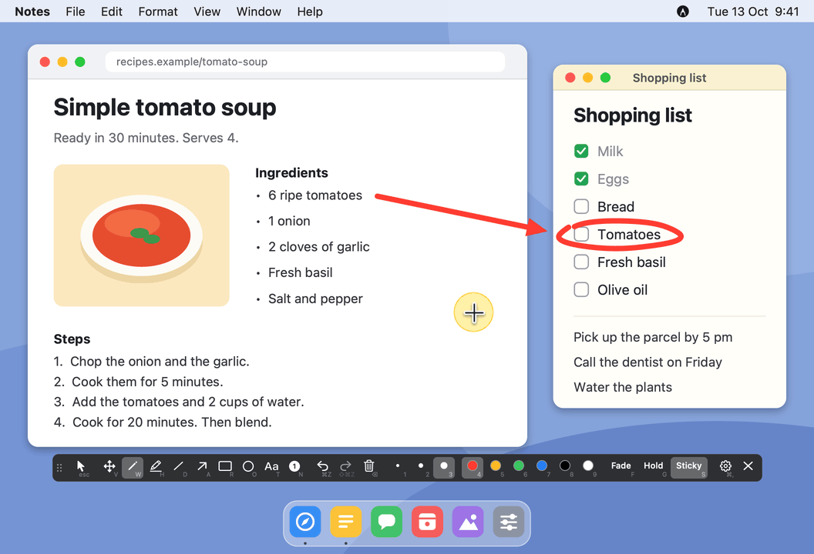
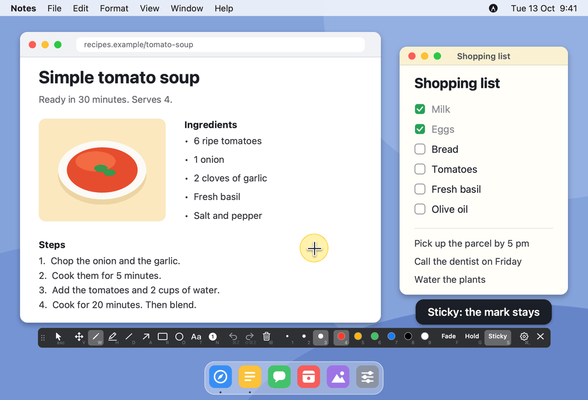
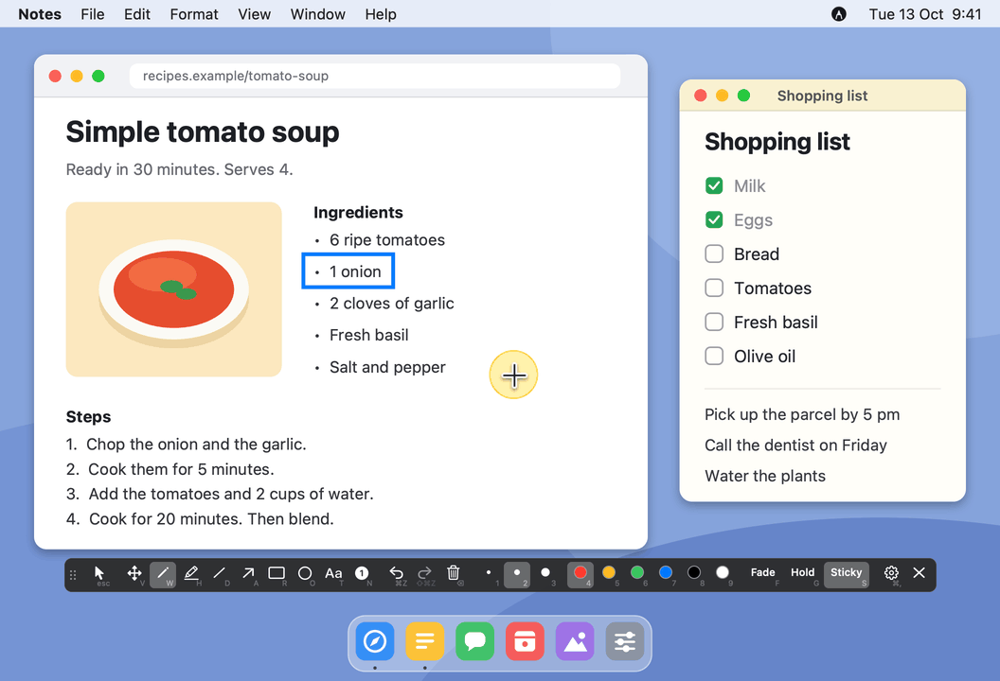
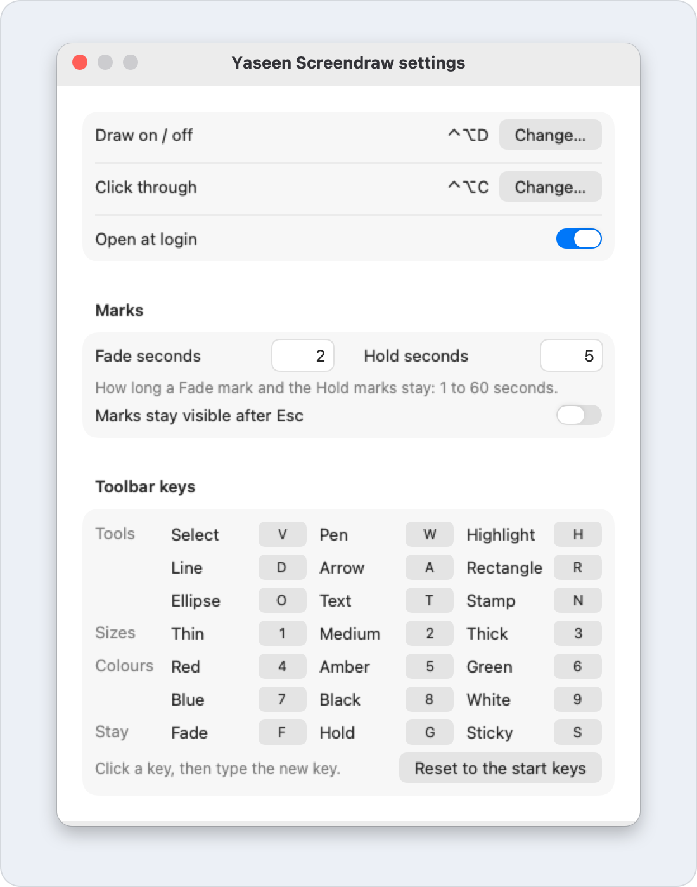

  

  
  
  

  <a href="https://github.com/yaseenarshad/yaseen-screendraw-app/releases/latest"><b>Download</b></a> ·
  <a href="#the-answer">How it works</a> ·
  <a href="#the-doubts">Questions</a> ·
  <a href="docs/GUIDE.md">Guide</a>

  <b>People see exactly where to look, because you draw it on your screen, on top of any app.</b>

  

  <a href="https://github.com/yaseenarshad/yaseen-screendraw-app/releases/latest"><b>Download for Mac</b></a> 
  Free · Apple Silicon · macOS 14 or later · a 387 KB download · no permission

## The problem

Every time I shared my screen, I ended up wiggling my mouse and saying "no, look here". The screen pen I tried would not let me change its keys. So I built a small one where you can customize any key.

Maybe you know these moments:

- You point with the mouse, and people still ask "where?"
- You turn on a pen tool, and now you can't click anything under it.
- You draw five marks, and then you have to clean them up by hand.
- Its shortcut clashes with an app you use, and you can't change it.

## The answer

Yaseen Screendraw lets you draw on top of any app, click through your marks, and change the keys.

<table>
  <tr>
    <td align="center" width="33%"> <b>1. Press the hotkey</b> Your pointer is a pen.</td>
    <td align="center" width="33%"> <b>2. Draw</b> One key for each tool.</td>
    <td align="center" width="33%"> <b>3. Keep working</b> Your marks stay.</td>
  </tr>
</table>

## What it does

### Draw on top of anything

Press **Control-Option-D** in any app. Your pointer is now a pen, above each window, a full-screen app, the menu bar and the Dock. Each tool, size and colour has one key: **A** for an arrow, **R** for a rectangle, **4** for red.

**So what:** you do not look for a button while people wait. You press one key and draw.

  

### Keep working under your marks

Press **Control-Option-C**. Your marks stay on the screen, and your clicks and your keys go to the app below. Press it again, and you draw again. While drawing is off, the same key shows the toolbar with the pen paused.

**So what:** you do not choose between your marks and your work. You click the next button, and your arrow is still there.

  

### Marks that clean up by themselves

One switch on the toolbar sets how long a new mark stays:

- **Fade:** the mark is gone after 2 seconds.
- **Hold:** the marks stay while you draw. They fade together 5 seconds after your last mark.
- **Sticky:** the mark stays until you clear it.

You set the two times yourself, from 1 to 60 seconds.

**So what:** you point at ten things in a row, and you clean up nothing.

  

### Fix a mark, and number your steps

Press **V** for Select. Drag a mark to move it, or drag a handle of a shape to change its size. Press **N** for the number stamp: each click puts the next number, 1, 2, 3. Hold **Shift** for a straight line, a square or a circle.

**So what:** you correct one mark and keep the others. And your steps have numbers that people can follow.

  

### Make the keys yours

Change the two hotkeys. Change each of the 21 toolbar keys: nine tools, three sizes, six colours, and Fade, Hold, Sticky. If a key is taken, a red line tells you, and your old key stays.

**So what:** when a shortcut clashes with an app that you use, you change it and continue.

  

And the small things:

- The toolbar is one row. Drop it at the left or the right edge of a screen, and it becomes a column. It stays where you put it.
- Rest the pointer on a button, and a tip shows its name and its key.
- Undo goes back 200 steps. After a clear, one Undo brings all the marks back.
- Stop with Control-Option-D, and your Sticky marks are there again the next time.
- The app remembers your tool, your size, your colour and the switch.
- The app lives in the menu bar. It has no Dock icon.

## The proof

Each number is measured on version 0.2.1, not estimated.

| What | Number |
| -- | -- |
| The download | 387 KB (387,221 bytes) |
| The app | About 1 MB (988 KB, built from the source of 0.2.1) |
| The time of the app for one new point of a pen line | 0.01 to 0.05 ms on average (a line of 5,000 points, 7 runs on an M1 Max) |
| Automatic tests | 262 |
| macOS permissions that the app asks for | 0 |

The pen number is the time of the code of the app. It does not include the time that macOS needs to show the line. For comparison: a screen with 120 pictures each second shows a new picture each 8.3 ms.

What the app does not need:

- No permission. The app draws on top of your screen. It does not read your screen.
- No account.
- No payment.
- No internet. The app has no network code.
- No outside code. It is a native Mac app, written in Swift.

And two more facts:

- The app writes no mark to the disk. Quit, and the marks are gone.
- While drawing is off, the app has no window on your screen and runs no timer.

## The doubts

**Is it safe?**
The app does not read your screen: it only draws on top of it. It has no network code. The code is in this repo, and you can read it.

**Does it work with two screens?**
Yes. You draw on each screen, and one toolbar serves all of them. A mark stays on the screen where you started it.

**Does it cost money?**
No. It is free, with the [MIT license](LICENSE).

**Why does macOS warn me at the first start?**
Apple has not checked the app. The name of that check is notarization, and it needs a paid Apple developer account. You click "Open Anyway" one time.

**Does it run on an Intel Mac or on Windows?**
No. It is for Macs with Apple Silicon only.

## The download

[**Download the newest `.dmg`**](https://github.com/yaseenarshad/yaseen-screendraw-app/releases/latest). The app needs a Mac with Apple Silicon and macOS 14 or later.

1. Open the `.dmg`. Drag **Yaseen Screendraw** to **Applications**.
2. Open the app. macOS stops it the first time. Go to **System Settings › Privacy & Security** and click **Open Anyway**.
3. Look for the pencil icon in the menu bar. The app is ready.

There is no permission step. The first start turns on "Open at login". You can turn it off in Settings.

The first three things to try:

1. Press **Control-Option-D** and draw a circle around something. Press **Esc** to clear it and stop.
2. Press **Control-Option-D** again. Press **A** and draw an arrow. Then press **Control-Option-C** and click in the app below. The arrow stays.
3. Press **Control-Option-C** again to get the pen back. Press **F** and draw. Each mark is gone after 2 seconds. Press **S** to make your marks stay again.

The four keys to remember:

| Key | What it does |
| -- | -- |
| Control-Option-D | Draw on and off. |
| Control-Option-C | Click through your marks, and back. While drawing is off: show the toolbar. |
| Esc | Clear all the marks and stop. |
| Delete | Clear all the marks, or only the selected mark. Drawing stays on. |

You can change the first two in Settings. The [guide](docs/GUIDE.md) has each other key.

## For developers

The app is one Swift package: a library, a small executable and the tests, with no outside package. The [developer page](docs/DEVELOPMENT.md) tells how to build, test, sign and release it. The [guide](docs/GUIDE.md) has each detail for users.

The license is [MIT](LICENSE).
